# Utilitário de Disco|deepin-diskmanager|

## Visão Geral

O Utilitário de Disco é uma ferramenta prática de gerenciamento de disco que ajuda os usuários a visualizar informações básicas dos discos, além de criar e gerenciar volumes lógicos.

## Guia

Você pode executar, fechar e criar um atalho na área de trabalho para o Utilitário de Disco das seguintes maneiras:

### Executar o Utilitário de Disco

1. Clique em  no Dock para abrir a interface do Iniciador.
2. Localize  rolando a roda do mouse ou pesquisando por "utilitário de disco" na interface do Iniciador e clique nele para executar. Uma caixa de diálogo de autenticação será exibida. Digite a senha para autenticar.

   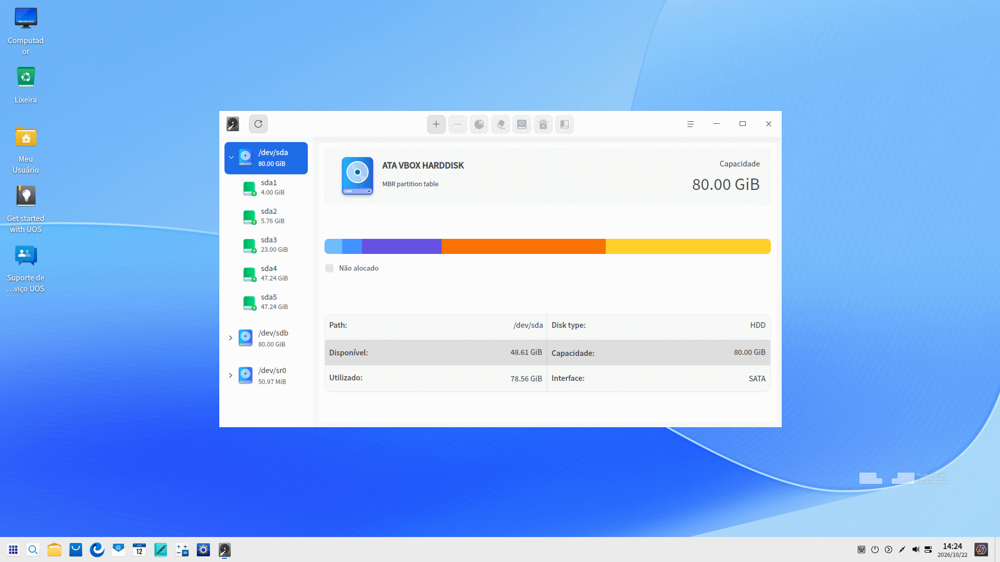

3. Clique com o botão direito em  para:

 - Clicar em **Enviar para a área de trabalho** para criar um atalho na área de trabalho.
 - Clicar em **Fixar no dock** para fixar o aplicativo no Dock.
 - Clicar em **Adicionar à inicialização** para que o aplicativo seja executado automaticamente ao iniciar o sistema.

### Sair do Utilitário de Disco

- Na interface do Utilitário de Disco, clique em  para sair.
- Clique com o botão direito em  no Dock e selecione **Fechar tudo** para sair.
- Na interface do Utilitário de Disco, clique em  e selecione **Sair** para fechar o aplicativo.

## Operações Gerais

### Gerenciamento de Disco

Na interface do Utilitário de Disco, você pode visualizar informações sobre os discos, gerenciar a integridade, criar tabelas de partição, etc. Quanto às partições, você pode criar, redimensionar, limpar, montar, desmontar e excluir partições.

> Atenção: 
>
>- Forçar o encerramento do aplicativo durante uma operação pode causar problemas no funcionamento do Utilitário de Disco. Prossiga com cautela.
>- Se uma partição do disco do sistema for uma partição estendida MBR, partição lógica ou volume lógico, opere com extremo cuidado para evitar falhas no sistema.

#### Exibir Informações do Disco

1. Na interface do Utilitário de Disco, uma lista de disco(s) e informações sobre as partições correspondentes são exibidas. Clique no ícone  para atualizar a interface atual.
    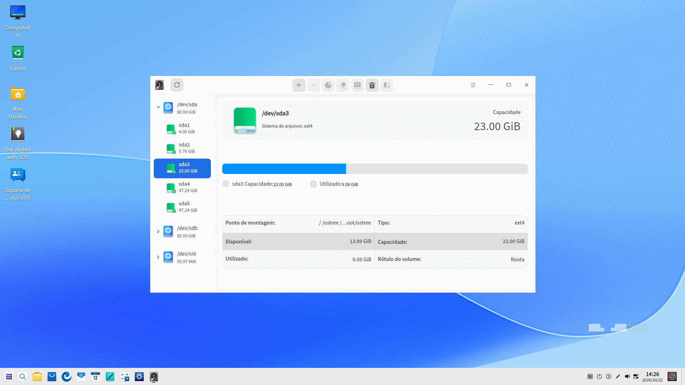

2. Clique com o botão direito em um disco e selecione **Informações do disco** para visualizar dados como modelo, fabricante, tipo de mídia, tamanho, interface e muito mais.

   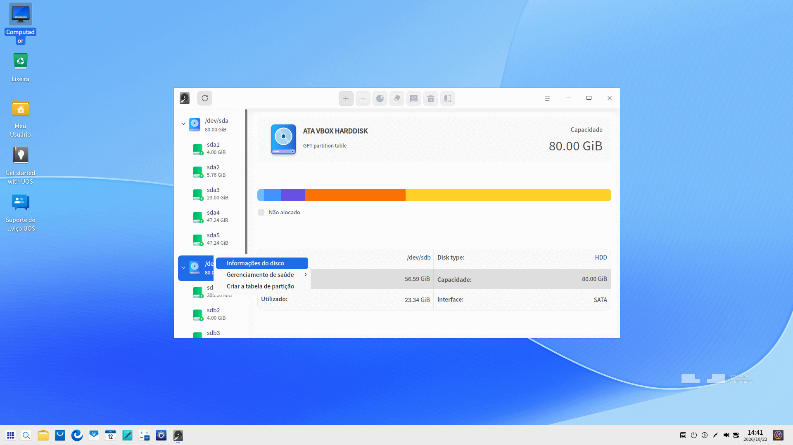
   
3. Clique em **Exportar** para salvar as informações do disco na pasta especificada.

#### Criar Tabela de Partição

Existem dois casos para a criação de uma tabela de partição:

- Se o disco estiver em estado normal, mas não possuir tabela de partição, ele não poderá ser operado. Portanto, crie uma tabela de partição previamente.
- Se já existir uma tabela de partição no disco (como MSDOS), é possível convertê-la para a tabela de partição GPT após criar uma nova tabela.

Observe que você precisa desmontar todas as partições do disco antes de realizar as operações acima.

1. Na interface do Utilitário de Disco, clique com o botão direito em um disco e selecione **Criar tabela de partição**.
2. Selecione partição GPT ou MSDOS e clique em **Criar**.

>  Atenção: Todas as partições deste disco serão mescladas e todos os dados serão perdidos durante o processo de criação de uma nova tabela de partição. Faça backup dos seus dados primeiro.

#### Executar Gerenciamento de Integridade

**Verificar Integridade**

1. Na interface do Utilitário de Disco, selecione um disco. Clique nele com o botão direito e selecione **Gerenciamento de saúde** > **Verificar integridade**. 
2. Você pode verificar o status de saúde, a temperatura atual e o estado dos diferentes atributos do disco.

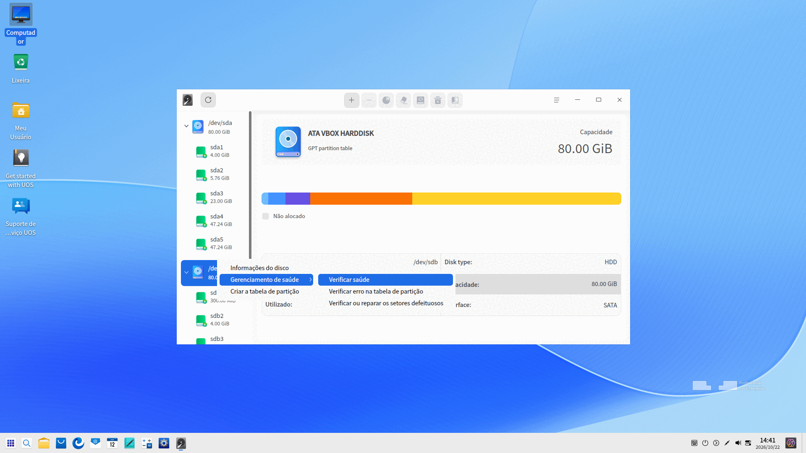
&nbsp;&nbsp;&nbsp;&nbsp;&nbsp;&nbsp;&nbsp;&nbsp;&nbsp;&nbsp;&nbsp;&nbsp;&nbsp;

3. Clique em **Exportar** para exportar os resultados da verificação de integridade do disco para a pasta desejada.

**Verificar Erro na Tabela de Partição**

1. Na interface do Utilitário de Disco, selecione um disco. Clique nele com o botão direito e selecione **Gerenciamento de saúde** > **Verificar erro na tabela de partição**. 
2. Se não houver erro na tabela de partição, uma mensagem informando **Nenhum erro encontrado na tabela de partição** será exibida; se algum erro for detectado, um relatório de erros na tabela de partição será exibido.

**Verificar/Reparar Setores Defeituosos**

Setores defeituosos (bad sectors) podem ocorrer com frequência em discos e devem ser verificados e reparados periodicamente.

1. Na interface do Utilitário de Disco, clique com o botão direito em um disco e selecione **Gerenciamento de saúde** > **Verificar ou reparar setores defeituosos**.

2. Defina o intervalo e o método de verificação e clique em **Iniciar Verificação** para examinar o disco selecionado.

   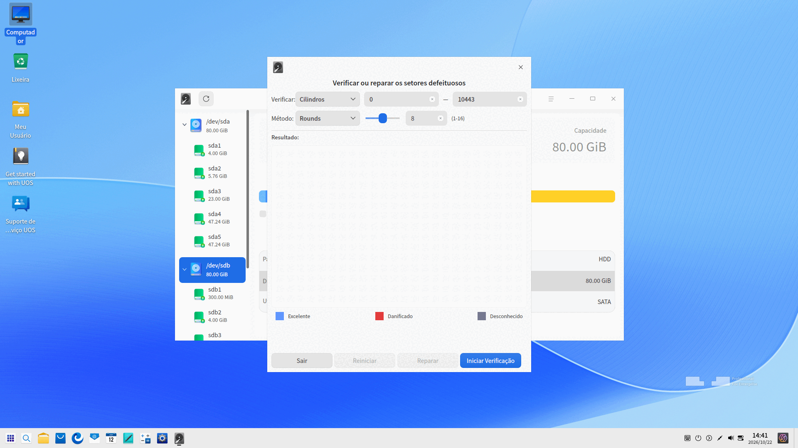

3. Clique em **Parar** para interromper a verificação a qualquer momento e em **Continuar** para retomá-la.

4. Você pode executar as seguintes operações após a conclusão da verificação:

- Sair da interface de verificação diretamente quando nenhum setor defeituoso for detectado.
- Clicar em **Reparar** para corrigir os setores defeituosos detectados.

> Atenção: A reparação de setores defeituosos pode destruir dados gravados neles ou em áreas adjacentes. Faça backup de todos os dados antes do reparo.

Você também pode clicar em **Redefinir** para limpar os dados detectados atualmente e retornar à tela inicial de **Verificar ou reparar setores defeituosos**.

#### Criar uma Partição

1. Na interface do Utilitário de Disco, selecione uma partição não alocada e clique no ícone Partição  na barra de ferramentas superior.
2. Uma caixa de diálogo de confirmação será exibida. Clique em **Confirmar** para entrar na tela de particionamento do espaço não alocado, onde é possível visualizar o tamanho, nome e sistema de arquivos da partição, além de ler informações do disco onde ela se localiza.
3. Na área de informações da partição, preencha o nome e o tamanho da partição e selecione o sistema de arquivos desejado. Atualmente, há suporte para criptografia AES / SM4.

   - Não criptografar: o espaço para a nova partição deve ser superior a 52 MiB.
   - Criptografia AES / SM4: o espaço para a nova partição deve ser superior a 100 MiB. O disco do sistema não pode ser criptografado.

>  Atenção: É possível criar no máximo quatro partições MSDOS. Para partições GPT, é possível criar no máximo 24 partições de uma só vez e até 128 partições no total.

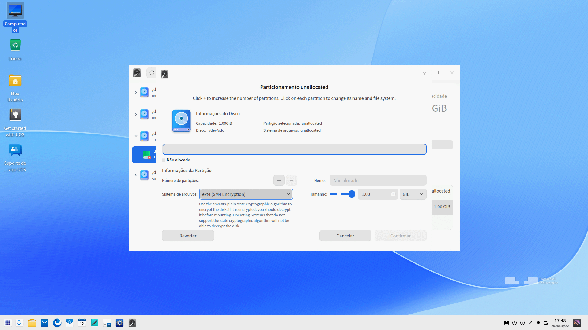

4. Se optar por criptografar, clique no ícone . Após definir a senha na janela pop-up, clique em **Confirmar**.

   - A senha não pode ser redefinida ou recuperada online, portanto, guarde-a com segurança.
   - A senha deve conter de 1 a 256 caracteres, incluindo letras em inglês, números e símbolos.
   - Dica de senha: pode ter no máximo 50 caracteres e não deve ser idêntica à senha.

   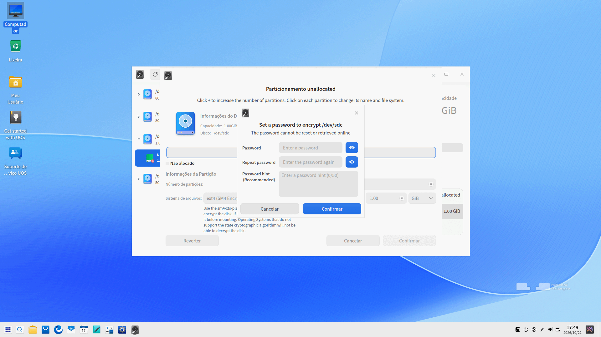

5. A partição recém-criada será exibida em segmentos no gráfico de barras. Você pode criar várias partições. Para excluir uma partição, clique no ícone .

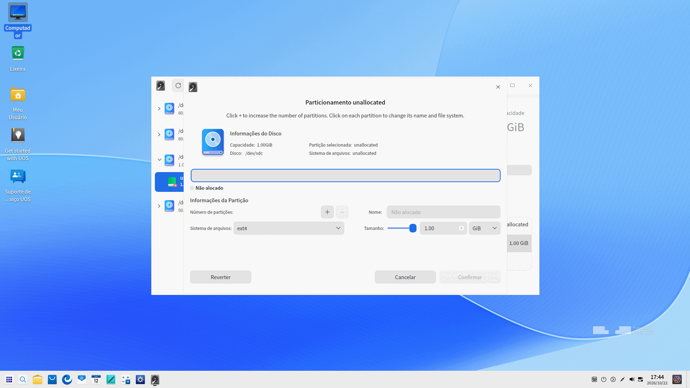

6. Clique em **Confirmar** após concluir as operações. A partição recém-criada será exibida sob o disco correspondente.
7. A nova partição será formatada automaticamente ao ser criada. Você poderá utilizá-la após montá-la manualmente. Consulte [Montar uma Partição](#montar-uma-partição) para mais detalhes.

> Notas: É necessário desbloquear as novas partições antes de montá-las caso estejam criptografadas com AES / SM4. Sistemas sem suporte ao Algoritmo Criptográfico Estatal não conseguirão desbloquear partições criptografadas com SM4.

#### Redimensionar uma Partição

Observe que só é possível redimensionar partições desmontadas e não criptografadas.

1. Na interface do Utilitário de Disco, selecione uma partição desmontada e clique no ícone Redimensionar  na barra de ferramentas superior.
2. Uma janela de redimensionamento será exibida. Preencha a nova capacidade.

   - Expandir espaço: Atualmente suporta expansão para a direita (espaço contíguo posterior). Só é possível expandir espaço quando houver uma partição não alocada contígua após a partição selecionada, e a nova capacidade não poderá exceder a capacidade total da partição atual somada ao espaço não alocado. Caso contrário, não será possível expandir a partição.
   - Reduzir espaço: Faça backup dos seus dados antes de iniciar a operação.

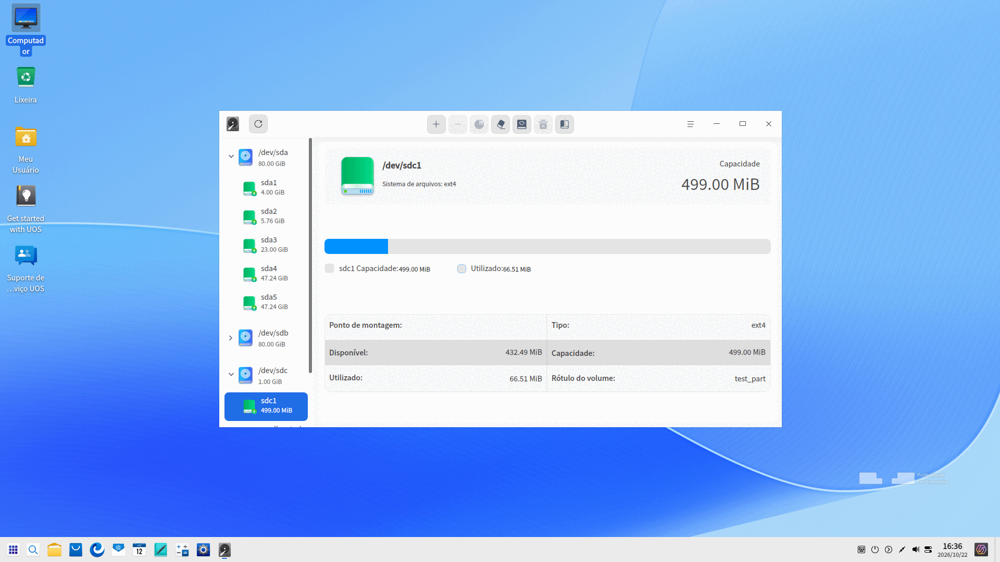

3. Clique em **Confirmar**. Você poderá visualizar a nova capacidade da partição assim que ela for redimensionada.

> Notas: Partições com o sistema de arquivos FAT32 não podem ser reduzidas.

#### Limpar um Disco/Partição

É possível limpar discos e partições que estejam desmontados. Você também pode alterar o sistema de arquivos criptografado para um não criptografado por meio da limpeza.

1. Na interface do Utilitário de Disco, selecione um disco ou partição e clique no ícone Limpar  na barra de ferramentas superior.
2. Uma tela de limpeza será exibida. Preencha o nome e selecione o sistema de arquivos e a opção de segurança. Há suporte para criptografia AES / SM4. Existem três opções de segurança: Rápido, Seguro e Avançado, sendo Rápido a opção padrão.
   - Rápido: Apenas exclui as informações de partição sem apagar fisicamente os arquivos do disco. Ferramentas de recuperação de dados podem conseguir recuperar arquivos com certa probabilidade.
   - Seguro: É uma limpeza segura única que segue a norma NIST 800-88, gravando 0, 1 e dados aleatórios em todo o disco uma vez. Os arquivos não poderão ser recuperados e o processo é mais demorado.
   - Avançado: Existem dois métodos de limpeza: DoD 5220.22-M e Gutmann. Grava 0, 1 e dados aleatórios em todo o disco várias vezes. Você pode definir a quantidade de passagens de sobregravação de dados, mas o processo será muito lento.

>  Notas: Os métodos de limpeza DoD 5220.22-M e Gutmann não estão disponíveis para unidades de estado sólido (SSD). Em SSDs, apenas as opções Rápido e Seguro estarão disponíveis na lista suspensa de segurança.

3. Clique em **Limpar**. Se optou por criptografar, será necessário definir uma senha. A partição limpa será montada automaticamente.

#### Montar uma Partição

Se partições criptografadas com AES / SM4 forem desmontadas, será necessário desbloqueá-las antes de montá-las novamente. Sistemas sem suporte ao Algoritmo Criptográfico Estatal não conseguirão desbloquear partições criptografadas com SM4.

1. Na interface do Utilitário de Disco, selecione uma partição desmontada e clique no ícone Montar  na barra de ferramentas superior.
2. Uma janela de montagem será aberta. Selecione ou crie um ponto de montagem e clique no ícone **Montar** para efetivar a ação.

   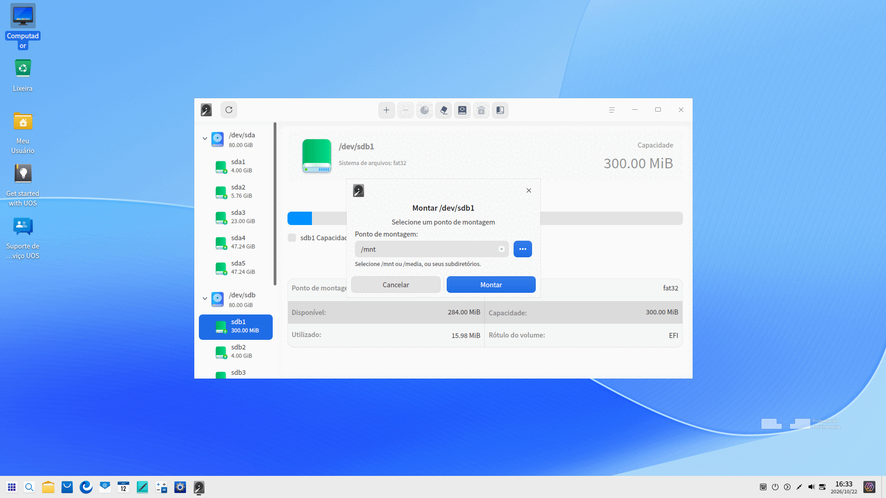

>  Atenção: Uma partição pode ser montada em um diretório existente, mesmo que não esteja vazio. No entanto, após a montagem, todos os arquivos e conteúdos anteriores desse diretório ficarão inacessíveis enquanto a partição estiver montada. Prossiga com cautela.

#### Desmontar uma Partição

Se desejar alterar o ponto de montagem de uma partição, você pode desmontá-la primeiro e, em seguida, montá-la novamente.

1. Na interface do Utilitário de Disco, selecione uma partição e clique no ícone Desmontar  na barra de ferramentas superior.
2. Uma caixa de diálogo de confirmação será exibida. Clique em **Desmontar** se tiver certeza de que nenhum programa está em execução ou acessando a partição.

   >  Atenção: Desmontar o disco do sistema pode causar travamento geral do sistema. Opere com extremo cuidado.

#### Excluir uma Partição

Após a exclusão de uma partição, todos os dados contidos nela serão perdidos. Prossiga com cautela.

1. Na interface do Utilitário de Disco, selecione uma partição desmontada e clique nela com o botão direito.
2. Selecione **Excluir partição** e uma caixa de diálogo de confirmação será exibida. Clique em **Excluir**, e a partição será removida do disco correspondente.

### Gerenciador de Volumes Lógicos (LVM)

O Gerenciador de Volumes Lógicos é uma camada lógica baseada em discos e partições. Com ele, você pode criar e gerenciar volumes lógicos em vez de usar os discos rígidos físicos diretamente, aumentando significativamente a flexibilidade do gerenciamento de armazenamento.

#### Criar um Grupo de Volumes

1. Na interface do Utilitário de Disco, clique no ícone Criar grupo de volumes  na barra de ferramentas superior. Uma janela de confirmação será exibida. A criação de um volume lógico formatará o sistema de arquivos da partição original. Faça backup dos dados primeiro.
2. Clique em **Confirmar** para entrar na interface de Criação de grupo de volumes, onde é possível visualizar e selecionar o nome e a capacidade dos discos e partições disponíveis. Os discos e partições que não são exibidos incluem:

   - O disco onde a partição de inicialização (boot) está localizada
   - Discos somente leitura
   - Partições ou discos já adicionados a outro volume lógico
   - Partições montadas
   - Partições não alocadas que não podem ser usadas para criar novas partições
   - Discos com erros na tabela de partição
   - Partições ou discos com capacidade inferior a 100 MiB

   

3. Selecione o disco e a partição desejados e clique em **Avançar**.
4. Na tela de criação do grupo de volumes, o disco ou partição selecionado será exibido na parte superior. Clique no botão excluir  para remover um disco ou partição, ou no botão adicionar  para adicioná-lo novamente. Quando a partição selecionada for ociosa ou o disco não tiver tabela de partição, o intervalo de espaço disponível para o grupo de volumes será exibido na parte inferior. Você pode personalizar o tamanho dentro desse limite.

   

5. Clique no botão **Concluir** para finalizar a criação do grupo de volumes. O grupo de volumes recém-criado será exibido no painel esquerdo com o nome padrão vg01, vg02, etc.

   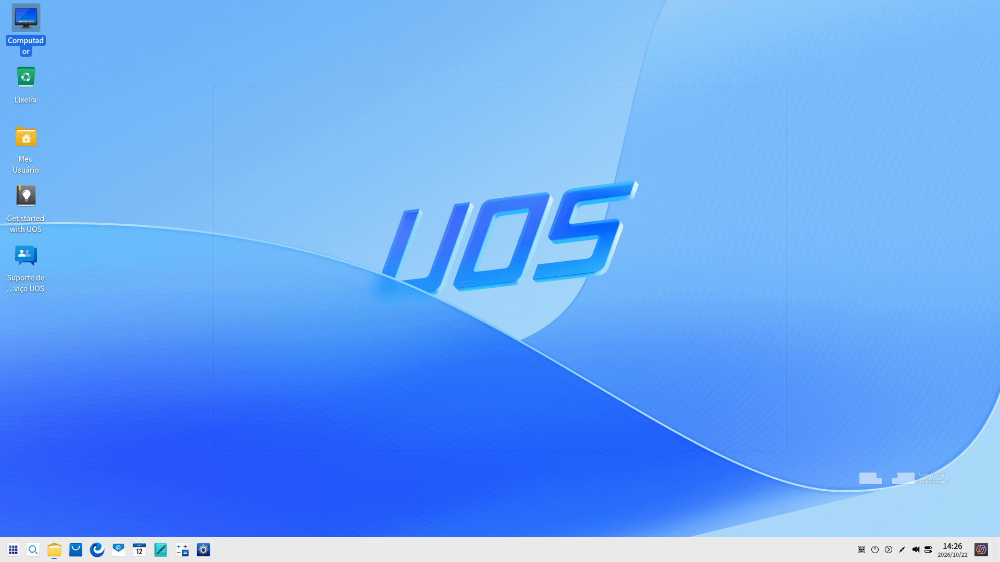

#### Criar um Volume Lógico

1. Na interface do Utilitário de Disco, selecione um volume lógico não alocado ou um grupo de volumes com espaço não alocado e clique no ícone Criar volume lógico  na barra de ferramentas superior.
2. Uma caixa de diálogo de confirmação será exibida. Clique em **Confirmar** para acessar a tela de criação de volumes lógicos, onde é possível visualizar tamanho, nome, sistema de arquivos e outras informações.
3. Na tela de criação, defina o tamanho do volume e selecione o sistema de arquivos do LV. Atualmente, há suporte para criptografia AES / SM4.

   - Não criptografar: o espaço para o novo volume lógico deve ser superior a 4 MiB e ser um múltiplo inteiro positivo de 4 MiB.
   - Criptografia AES / SM4: o espaço para o novo volume lógico deve ser superior a 100 MiB.

4. Se optar por criptografar, clique no ícone . Após definir a senha na janela pop-up, clique em **Confirmar**.

   - A senha não pode ser redefinida ou recuperada online, portanto, guarde-a com cuidado.
   - A senha deve conter de 1 a 256 caracteres com letras em inglês, números e símbolos.
   - Dica de senha: pode ter no máximo 50 caracteres e não deve coincidir com a senha.

5. O volume lógico recém-criado será exibido em segmentos no gráfico de barras. É possível criar vários volumes lógicos. Para excluir um volume lógico, clique no ícone .

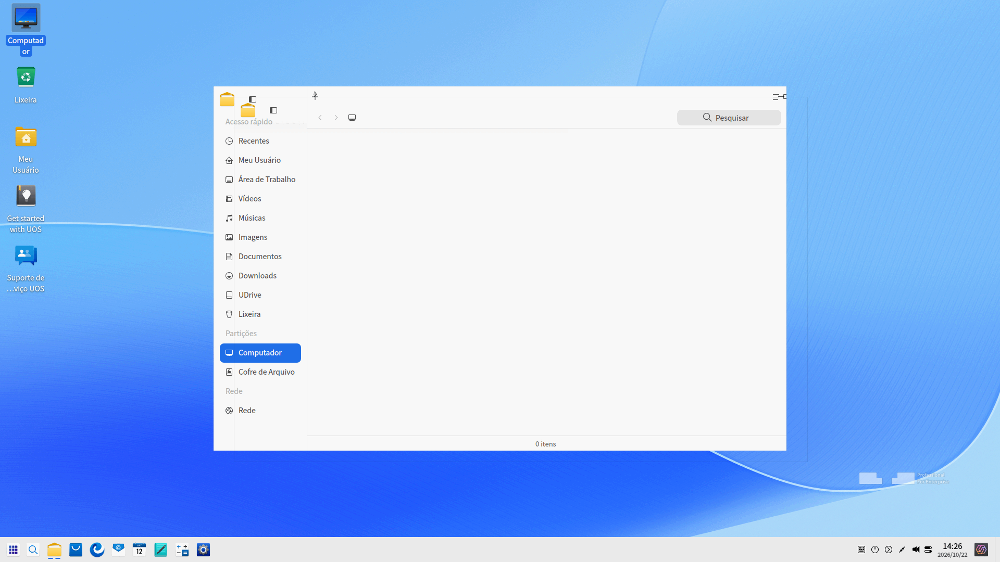

6. Clique em **Confirmar** após concluir as operações. O novo volume lógico será automaticamente formatado e montado assim que for criado.
7. O volume lógico recém-criado será exibido sob o grupo de volumes lógicos correspondente.

> Notas: É necessário desbloquear os novos volumes lógicos antes de montá-los caso estejam criptografados com AES / SM4. Sistemas sem suporte ao Algoritmo Criptográfico Estatal não conseguirão desbloquear volumes lógicos criptografados com SM4.

#### Redimensionar um Grupo de Volumes/Volume Lógico

É possível redimensionar um grupo de volumes ou volume lógico de acordo com as necessidades reais. Faça backup dos seus dados antes de reduzir o tamanho de um grupo de volumes ou volume lógico.

Consulte [Redimensionar uma Partição](#redimensionar-uma-partição) na seção Gerenciamento de Disco para obter detalhes sobre as operações de redimensionamento de um volume lógico. Observe que volumes lógicos com sistema de arquivos FAT32 não podem ser redimensionados.

Consulte os seguintes passos para redimensionar um grupo de volumes:

1. Na interface do Utilitário de Disco, selecione um grupo de volumes e clique no ícone Redimensionar  na barra de ferramentas superior.
2. Uma tela de redimensionamento será exibida mostrando todos os discos e partições disponíveis. Você pode optar por expandir ou reduzir o espaço.

   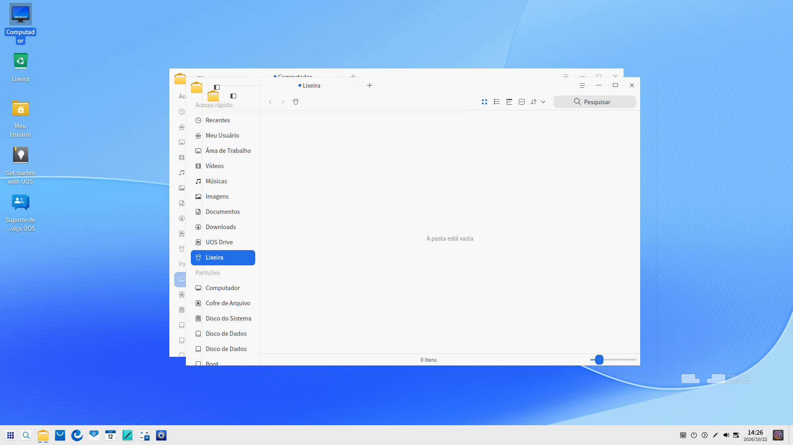

3. Selecione os discos e partições correspondentes e clique em **Avançar**.
4. Os discos ou partições selecionados serão exibidos na parte superior da interface de redimensionamento. Clique em  ou  para adicionar ou remover um disco ou partição, respectivamente. Quando a partição selecionada for ociosa ou o disco selecionado não possuir tabela de partição, o intervalo de configuração do espaço do grupo de volumes será exibido na parte inferior. Você pode personalizar o espaço dentro do intervalo permitido.

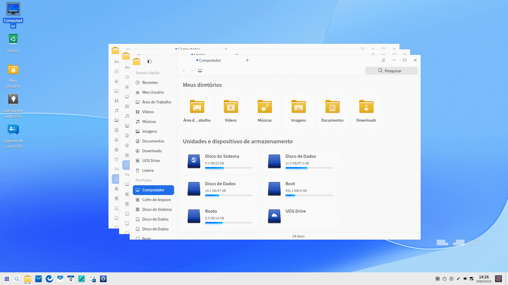

5. Clique no botão **Concluir** para finalizar o redimensionamento do grupo de volumes.

#### Limpar um Volume Lógico

A limpeza de um volume lógico é semelhante à de um disco ou partição. Consulte [Limpar um Disco/Partição](#limpar-um-discopartição) na seção Gerenciamento de Disco.

#### Montar um Volume Lógico

A montagem de um volume lógico é semelhante à de uma partição. Consulte [Montar uma Partição](#montar-uma-partição) na seção Gerenciamento de Disco.

#### Desmontar um Volume Lógico

A desmontagem de um volume lógico é semelhante à de uma partição. Consulte [Desmontar uma Partição](#desmontar-uma-partição) na seção Gerenciamento de Disco.

#### Excluir um Volume Lógico

Os dados não poderão ser recuperados após a exclusão de um volume lógico. Prossiga com cautela.

Pré-requisitos: O volume lógico deve estar desmontado.

1. Selecione um volume lógico desmontado e clique com o botão direito para escolher **Excluir volume lógico** ou clique no ícone  na barra de ferramentas superior.
2. Clique no ícone **Excluir**, e a capacidade do volume lógico excluído será liberada de volta para o espaço não alocado no grupo de volumes.

#### Excluir um Grupo de Volumes

Os dados não poderão ser recuperados após a exclusão de um grupo de volumes. Prossiga com cautela.

Pré-requisitos: Certifique-se de que todos os volumes lógicos do grupo de volumes estejam desmontados antes de excluí-lo.

1. Selecione um grupo de volumes e clique com o botão direito para escolher **Excluir grupo de volumes** ou clique no ícone  na barra de ferramentas superior.
2. Clique no ícone **Excluir** para removê-lo.

#### Excluir um Volume Físico

1. Selecione um disco ou partição que tenha sido adicionado ao grupo de volumes lógicos e clique no ícone  na barra de ferramentas superior.
2. Os dados contidos serão perdidos após a exclusão do volume físico. Prossiga com cautela. Clique no ícone **Excluir** após a confirmação.
3. O volume físico poderá ser excluído se o seu espaço não for superior ao espaço restante do grupo de volumes. Caso contrário, ele não poderá ser excluído. Recomenda-se excluir o volume lógico correspondente primeiro e, em seguida, excluir o volume físico.

## Menu Principal

No menu principal, você pode alternar os temas da janela, visualizar o manual de ajuda e obter mais informações sobre o Utilitário de Disco.

### Tema

Existem três temas de janela: Tema Claro, Tema Escuro e Tema do Sistema.

1. Clique em  na interface do Utilitário de Disco.
2. Clique em **Tema** para escolher uma das opções.

### Ajuda

1. Clique em  na interface do Utilitário de Disco.
2. Clique em **Ajuda** para visualizar o manual do Utilitário de Disco.

### Sobre

1. Clique em  na interface do Utilitário de Disco.
2. Clique em **Sobre** para visualizar a versão e a apresentação do Utilitário de Disco.

### Sair

1. Clique em  na interface do Utilitário de Disco.
2. Clique em **Sair** para fechar o Utilitário de Disco.
